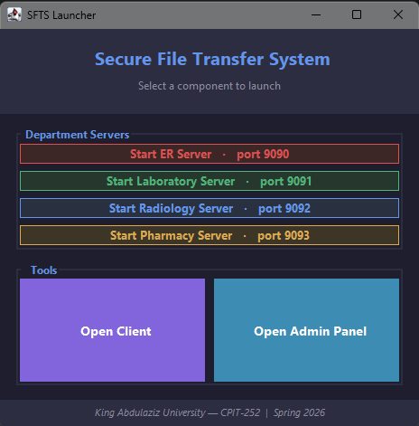
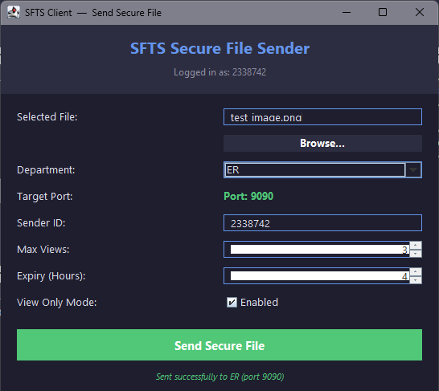
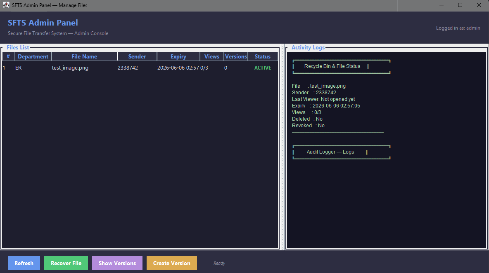

# Secure File Transfer System (SFTS)


---

## Group Members

| Name | Student ID |
|------|-----------|
| Motaz Alsayed | 2339709 |
| Abdulaziz Bukhari | 2338742 |
| Abdulmalik Aldahari | 2337862 |

---

## Generative AI Disclosure

In accordance with the course syllabus policy on the use of generative AI tools, we disclose that generative AI tools were used during the development of this project to assist with code suggestions, documentation writing, and problem-solving support. All final decisions, implementations, and understanding of the submitted work remain our own.

---

## Problem Description: Security Gaps in Medical Data Exchange

Healthcare collaboration is currently compromised by three critical issues:

- **Insecure Transfer Methods**: Reliance on USB drives and public email makes patient data vulnerable to loss and interception.
- **Lack of Access Control**: Existing systems fail to restrict data within teams, allowing unauthorized staff to view sensitive records.
- **Cyber Vulnerabilities**: Unencrypted network transfers expose the hospital to Man-in-the-Middle attacks and legal penalties for data breaches.

---

## Proposed Solution

SFTS is a **Java-based secure file transfer application** designed to provide a centralized, encrypted environment for medical collaboration.

---

## Core Features

| Feature | Description |
|---------|-------------|
| **Data Isolation** | Segregates records by department (e.g., Lab, ER) to prevent unauthorized cross-team access |
| **Identity & Accountability** | Enforces strict user verification and logs all file activities |
| **Secure Networking** | Uses a central server with isolated processing threads |
| **Controlled Operations** | Assigns unique IDs to documents and provides secure file management workflows |
| **Time-Limited Access** | Files expire automatically after a configured duration |
| **Maximum View Limits** | Files can be restricted to a specific number of views |
| **View-Only Mode** | Files can be previewed securely without allowing direct download |
| **Dynamic Watermarking** | Viewer identity is displayed on protected file previews |
| **View Tracking** | Records every file access event for auditing and monitoring |
| **File Versioning** | Maintains version history for secure files |
| **Recycle Bin & Recovery** | Deleted files can be moved to a recycle bin and restored later |

---

## System Architecture & Design Patterns

To ensure a scalable, secure, and maintainable architecture, the system uses the following design patterns:

### Proxy Pattern — `DepartmentProxy`
Acts as a security gateway by intercepting file processing requests and validating user authorization before allowing access to restricted departments.

### Factory Pattern — `DepartmentFactory`
Centralizes the creation of department objects such as Lab and ER, making the system easier to scale.

### Builder Pattern — `FileBuilder`
Provides a flexible step-by-step process for constructing complex `SecureFile` objects with required and optional security settings.

### Singleton Pattern — `AuditLogger`
Ensures that only one shared logger instance is used across the entire system for centralized audit logging.

### Observer Pattern — Behavioral Design Pattern
`FileObserver`, `AuditObserver`, `ViewTrackingObserver`, `VersionObserver`, `RecycleBinObserver`

Allows the system to notify multiple components when secure file events occur, such as:

- File opened
- File updated
- File deleted
- File restored
- Access denied

This pattern improves modularity by separating file event generation from event handling. Logging, tracking, versioning, and recycle bin behavior respond automatically to file actions without tightly coupling all logic into a single class.

---

## Screenshots

### Main Launcher
> **

### Server View 
> **

### Client 
> **

### Admin Panel  
> **


---

## How to Run

### Option 1: Run from IntelliJ IDEA

1. Open the project in **IntelliJ IDEA**.
2. Load **Maven dependencies** (IntelliJ will prompt you automatically).
3. Run `Main.java` to open the launcher.
4. Choose:
   - **Run Server** — starts the department server
   - **Run Client** — opens the file transfer client

### Option 2: Run the JAR file

After building the project:

```bash
java -jar target/sfts-final.jar
```

### Option 3: Run with Docker (Recommended for servers)

Make sure Docker Desktop is running, then from the project root:

```bash
docker compose up --build
```

This starts all 4 department servers (ER, Laboratory, Radiology, Pharmacy) as isolated containers on ports 9090–9093.

To stop:

```bash
docker compose down
```

---

## 🛠️ Build Instructions

To build the project as a JAR file using Maven:

```bash
mvn clean package
```

The generated binary file can be found in:

```
target/sfts-final.jar
```

---

## Docker Setup

The project includes a `Dockerfile` and `docker-compose.yml` for containerized deployment of department servers.

Each department runs as an independent container:

| Container | Department | Port |
|-----------|-----------|------|
| `er-server` | ER | 9090 |
| `lab-server` | Laboratory | 9091 |
| `radiology-server` | Radiology | 9092 |
| `pharmacy-server` | Pharmacy | 9093 |

Docker is used to demonstrate that each department server can run as an isolated, portable service — reflecting the system\'s security isolation principle.

---

## Technologies Used

| Technology | Purpose |
|-----------|---------|
| **Java 17** | Core programming language |
| **Swing** | Desktop GUI for server, client, and admin views |
| **Maven** | Build and dependency management |
| **Docker** | Containerized server deployment |
| **Docker Compose** | Multi-service orchestration |
| **Observer Pattern** | Behavioral event handling |
| **Builder Pattern** | Secure file construction |
| **Singleton Pattern** | Centralized audit logging |
| **Proxy Pattern** | Department access control |
| **Factory Pattern** | Department object creation |

---

## Project Structure

```
project-g2030
├── src
│   ├── main
│   │   └── java
│   │       └── sa/edu/kau/fcit/cpit252/project
│   │           ├── Main.java
│   │           ├── SFTSGui.java
│   │           ├── SFTSClient.java
│   │           ├── ServerLauncher.java
│   │           ├── core/
│   │           │   └── DepartmentServer.java
│   │           ├── model/
│   │           │   ├── SecureFile.java
│   │           │   ├── FileBuilder.java
│   │           │   └── FileVersion.java
│   │           ├── observer/
│   │           │   ├── FileObserver.java
│   │           │   ├── AuditObserver.java
│   │           │   ├── VersionObserver.java
│   │           │   ├── ViewTrackingObserver.java
│   │           │   └── RecycleBinObserver.java
│   │           ├── logger/
│   │           ├── security/
│   │           ├── service/
│   │           ├── proxy/
│   │           └── department/
├── Dockerfile
├── docker-compose.yml
├── pom.xml
└── .gitignore
```

---

## GitHub Project Management

The team uses a **GitHub Kanban Board** to manage project tasks:

- Tasks are assigned to individual team members.
- Progress is tracked through board columns.
- Issues are closed using related commit messages as required in the project instructions.

---

## Release

A **GitHub Release** has been created for the final submission. The binary JAR file is uploaded under the repository\'s **Releases** section as required.

---

## Project Status

The project is **complete** with all planned features implemented, including:

- ✅ Secure transfer logic
- ✅ Department-based access control
- ✅ Protected file handling (expiry, view limits, watermarking)
- ✅ Behavioral event observation (Observer Pattern)
- ✅ Admin panel with recycle bin and versioning
- ✅ Docker containerized deployment
  '''